# 🌍 Planet Pulse

[](https://github.com/jeti20/planet-pulse/actions/workflows/ci.yml)
[](./LICENSE)


**Observability for planet Earth, and for the public APIs that watch it.**

Planet Pulse treats the planet like a production system. Earthquakes, solar flares, geomagnetic
storms, weather and air quality become metrics, dashboards and alerts. The public APIs these
signals come from get **SLOs, error budgets and multi-window multi-burn-rate alerts** exactly as
described in Google's *Site Reliability Workbook*.

There is **no custom application code**. The pipeline is built from configuration only:
JSONPath in json-exporter, relabeling in Grafana Alloy, PromQL recording rules, and
provisioned Grafana dashboards and alerting. Everything is validated in CI with
`promtool`, unit tests, `pint`, `amtool` and `alloy validate`.

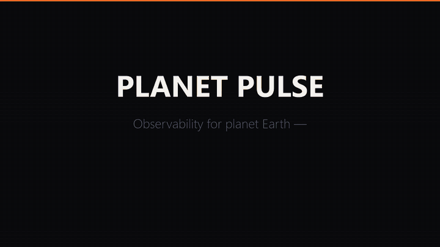

<sub>20-second tour. Full 79-second video: [`docs/video/planet-pulse.mp4`](docs/video/planet-pulse.mp4).</sub>

> 🇵🇱 **Po polsku:** projekt portfolio z obserwowalności. Zbiera publiczne dane o trzęsieniach
> ziemi (USGS), pogodzie kosmicznej (NOAA) oraz pogodzie i jakości powietrza (Open-Meteo).
> Robi to bez pisania aplikacji – tylko json-exporter + Grafana Alloy. Liczy SLO dla dostawców
> tych danych zgodnie z SRE Workbook Google'a. Ma reguły testowane jednostkowo (`promtool test`),
> lint PromQL (`pint`), alerty Prometheusa i Grafany wysyłane do ntfy oraz 7 dashboardów
> (w tym dokładne liczenie wywołań API i zużycia limitów).
> Uruchomienie: `docker compose up -d` → http://127.0.0.1:3000.

---

## Contents

- [Quick start](#quick-start)
- [Architecture](#architecture)
- [SLOs (Google SRE Workbook)](#slos-google-sre-workbook)
- [Alerting](#alerting-two-engines-two-jobs)
- [Dashboards](#dashboards)
- [Quality gates](#quality-gates)
- [Configuration](#configuration)
- [Customising](#customising)
- [Operations & troubleshooting](#operations--troubleshooting)
- [Security](#security)
- [Data sources & attribution](#data-sources--attribution)
- [Project layout](#project-layout)
- [Known limitations](#known-limitations)
- [License](#license)

---

## Quick start

**Requirements:** Docker with Compose v2 (Docker Desktop on Windows/macOS works) and about 1.5 GB
of RAM. Nothing else: every tool runs in a container.

```bash
git clone https://github.com/jeti20/planet-pulse.git
cd planet-pulse
cp .env.example .env          # optional - set your own Grafana admin password
docker compose up -d
```

| URL | What |
|---|---|
| http://127.0.0.1:3000 | **Grafana**: the home dashboard opens automatically. Anonymous users are *Editors* (dashboards can be edited and saved in the UI). Log in as `admin` for admin tasks. |
| http://127.0.0.1:8080/planet-pulse-planet | **ntfy**: push notifications. Topics: `planet-pulse-planet`, `-pages`, `-tickets`, `-heartbeat` |
| http://127.0.0.1:9090 | Prometheus: rules, alerts, TSDB |
| http://127.0.0.1:9093 | Alertmanager |
| http://127.0.0.1:12345 | Grafana Alloy: live component graph of the pipeline |

The first data shows up within a minute. Open-Meteo is scraped every 4 minutes, and the 30-day SLO
windows obviously need time to fill. All ports bind to `127.0.0.1` only (see [Security](#security)).

To get notifications on your phone, install the [ntfy app](https://ntfy.sh/) and subscribe to
`http://<your-machine>:8080/planet-pulse-planet`. You'll need to change `BIND_ADDR` for that,
so read the security notes first.

## Architecture

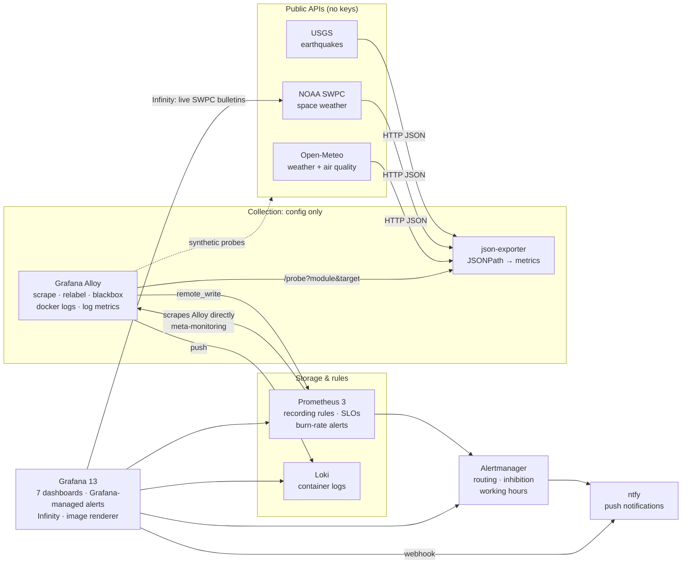

| Service | Image | Role |
|---|---|---|
| json-exporter | `prometheuscommunity/json-exporter:v0.8.0` | turns JSON APIs into Prometheus metrics with JSONPath |
| alloy | `grafana/alloy:v1.20.1` | scrapes, relabels, runs synthetic probes, collects container logs, remote_writes |
| prometheus | `prom/prometheus:v3.15.0` | TSDB, recording rules, SLOs, alert rules (45-day retention) |
| alertmanager | `prom/alertmanager:v0.34.1` | routing, grouping, inhibition, time-based routing |
| loki | `grafana/loki:3.7.8` | container logs (7-day retention) |
| grafana | `grafana/grafana:13.2.3` | dashboards, Grafana-managed alerting |
| renderer | `grafana/grafana-image-renderer:v5.12.6` | server-side PNG rendering of panels/dashboards |
| ntfy | `binwiederhier/ntfy:v2.29.0` | self-hosted push notifications with a web UI |

**Why it's built this way**

- **json-exporter instead of a poller.** Every metric is a JSONPath expression in
  [`json-exporter/config.yml`](json-exporter/config.yml). Adding a dataset means adding about 10
  lines of YAML.
- **Alloy builds the API URLs.** Cities live in [`alloy/cities.json`](alloy/cities.json) (file
  service discovery, hot-reloaded). `discovery.relabel` turns the `lat`/`lon` labels into the
  Open-Meteo URL with a regex. Adding a city doesn't need a restart.
- **Alloy's built-in blackbox exporter** runs synthetic probes. They measure latency by HTTP
  phase and TLS certificate expiry. No separate blackbox container.
- **Prometheus scrapes Alloy directly**, while everything else arrives via remote_write. If the
  collector breaks, the TSDB still knows (`NoUpstreamDataReceived`).
- **Logs → metrics in Alloy.** `loki.process` + `stage.metrics` counts log lines per
  service/level before shipping them. That gives the `ErrorLogsSpike` alert without querying Loki.

## SLOs (Google SRE Workbook)

The SLOs cover the **data providers**: the dependencies this whole system relies on.

| SLI | Good event | Objective (30 d) |
|---|---|---|
| **availability** | scrape of the JSON API succeeded (measured at the real consumer, json-exporter) | 99.5 % |
| **latency** | synthetic probe succeeded **and** took < 1 s | 99 % |
| **freshness** | data younger than 5 min (USGS) / 30 min (weather) / 2 h (air quality) | 99 % |

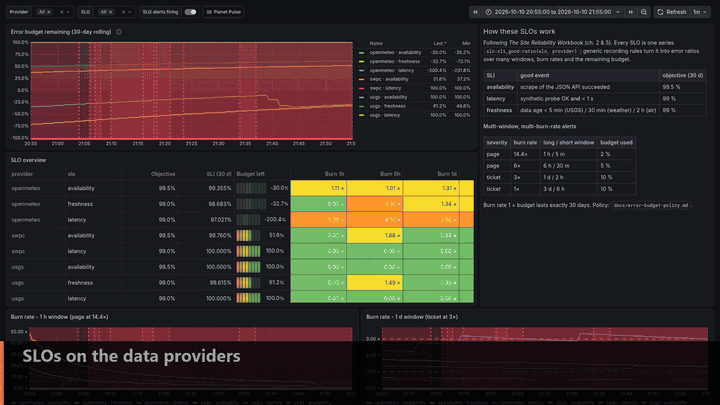

### One series per SLO, generic rules for the rest

[`prometheus/rules/slo.yml`](prometheus/rules/slo.yml) reduces every SLO to a single series,
`slo:sli_good:ratio{slo, provider}`. Everything else is generic and works for any future SLO:

```
slo:sli_error:ratio_rate{5m,30m,1h,2h,6h,1d,3d,30d}   = 1 - avg_over_time(slo:sli_good:ratio[w])
slo:burn_rate:{1h,6h,1d,3d,30d}                        = error ratio / (1 - objective)
slo:error_budget_remaining:ratio                       = 1 - burn_rate:30d
```

### Multi-window, multi-burn-rate alerts (Workbook ch. 5, table 5-8)

| Alert | Severity | Burn rate | Long window | Short window | Budget used when it fires |
|---|---|---|---|---|---|
| `SLOErrorBudgetBurnFast` | page | 14.4× | 1 h | 5 m | 2 % |
|  | page | 6× | 6 h | 30 m | 5 % |
| `SLOErrorBudgetBurnSlow` | ticket | 3× | 1 d | 2 h | 10 % |
|  | ticket | 1× | 3 d | 6 h | 10 % |
| `SLOErrorBudgetExhausted` | ticket | – | 30 d | – | 100 % |

What happens when the budget runs low is written down in the
[error budget policy](docs/error-budget-policy.md). Every paging alert has a
[runbook](docs/runbooks.md), and `pint` enforces that.

### Tuning the latency SLO: a real example

The latency threshold started at **500 ms**. The first hours of data showed Open-Meteo's p95 at
about 320 ms, but **~5 % of probes took 0.5–0.6 s**. Most of that time was server-side
`processing`, visible in the probe-phase panel. That's a steady **5× burn rate**: the
fast-burn page fired and would never stop. Nobody was actually affected: the consumer is a
scrape every 4 minutes. The threshold moved to **1 s**, and the reasoning is recorded in the
policy. An SLO should describe what users need, not what a provider happens to deliver on a
good day.

### A data-quality finding: GOES reports zero flux

While building the space-weather dashboard, the GOES X-ray feed started returning
`flux: 0.0` for about 30 minutes. Physically that's impossible, because the solar X-ray
background is never zero. `log10(0) = -Inf`, so the flare-class rule happily reported
**"class A"**: a confident, wrong answer. Fixes:

- the recording rule ignores zeros (`... > 0`), so the dashboard says *no data* instead of lying,
- a new **`UpstreamDataInvalid`** alert covers "the request works, the data is nonsense",
- a unit test reproduces the case.

Availability, freshness and **correctness** are different SLIs. This one wouldn't show up as an outage.

### A second one: the Kp estimate resets every 3 hours

On 2026-10-10 a real **G3 geomagnetic storm** (Kp 7) hit, and SWPC issued K07 alerts. At
21:00 UTC the dashboard suddenly said *Kp 0.33, "Aurora: not tonight"*. The storm hadn't ended:
the 1-minute **estimated** Kp restarts from ~0 at the start of every 3-hour synoptic period
(`7.0` at 20:59, `0.0` at 21:00). The geomagnetic-storm alert survived only because of
`keepFiringFor`. Fixes:

- a recording rule `space:kp:max30m = max(max_over_time(swpc_kp_estimated[30m]))` bridges the
  reset and now feeds the stats, the G-level rule and the Grafana alert,
- a unit test replays the 7 → 0 drop.

Lesson: know how the upstream computes a value before you alert on it.

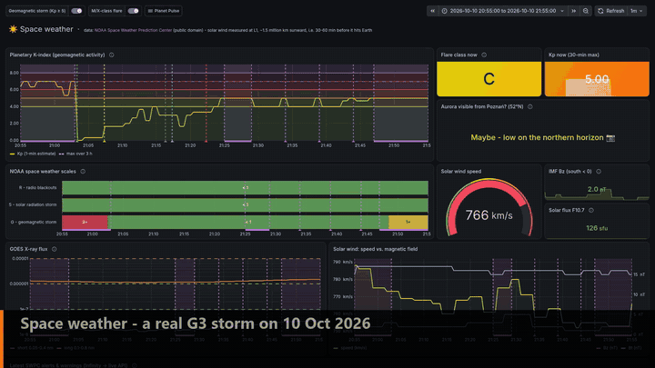

A side effect showed up while rolling the fix out. With Grafana's *incremental querying* enabled
on the Prometheus datasource, panels using the brand-new series kept showing **no data**: the
cached (empty) result of the full-dashboard query was reused and only extended. Rendered alone,
the same panel was fine. At this data volume the cache brings nothing, so it's disabled in
[`datasources.yaml`](grafana/provisioning/datasources/datasources.yaml).

## Alerting: two engines, two jobs

| | Prometheus + Alertmanager | Grafana-managed |
|---|---|---|
| **What** | SLO burn rates, platform health, data contracts | Events on the planet |
| **Rules** | `SLOErrorBudgetBurn*`, `StackComponentDown`, `NoUpstreamDataReceived`, `UpstreamSchemaDrift`, `UpstreamDataInvalid`, `UpstreamApiQuotaNearlyExhausted`, `UpstreamRateLimited`, `ErrorLogsSpike`, `Watchdog`… ([`prometheus/rules/`](prometheus/rules)) | Strong earthquake (one instance per quake), tsunami flag, geomagnetic storm (Kp ≥ 5, resolves < 4), M/X-class flare, poor air quality per city, wind gusts, error budget < 25 % ([`grafana/provisioning/alerting/`](grafana/provisioning/alerting)) |
| **Routing** | pages immediately · tickets only Mon–Fri 08–18 Europe/Warsaw · page inhibits ticket for the same SLO · `NoUpstreamDataReceived` inhibits per-endpoint noise | critical → urgent topic · weather notices muted 22:00–07:00 |
| **Delivered to** | ntfy (`template=alertmanager`) | ntfy (`template=grafana` + custom notification template) |

The `Watchdog` alert always fires and goes to the `planet-pulse-heartbeat` topic every hour. If it
stops arriving, the alerting pipeline itself is broken.

## Dashboards

All dashboards are provisioned from JSON in [`grafana/dashboards/`](grafana/dashboards).
Folders come from the directory structure.

| Dashboard | Highlights |
|---|---|
| **Planet Pulse** (home) | KPIs, world earthquake map, error budget per SLO, firing alerts |
| **Earthquakes** | Geomap (markers sized by magnitude, coloured by depth, plus a heatmap layer), event table with data links to USGS, regions via `label_replace`, Gutenberg-Richter histogram, annotations placed at the *actual* event time (`useValueForTime`) |
| **Space Weather** | Kp with NOAA G-scale bands, NOAA R/S/G state timeline, GOES X-ray flux on a log scale with flare-class thresholds, solar wind gauge, "Aurora visible from Poznań?" value mapping, **live SWPC bulletins via the Infinity datasource** |
| **Weather & Air Quality** | repeated rows per city, WMO weather codes → emoji value mappings, table with gauge cells, Geomap fit to data, PM2.5 vs WHO guideline |
| **SLO – upstream providers** | error budget burn-down, SLO table merged from 7 queries, burn-rate graphs with alert thresholds, status history, HTTP probe phases, TLS expiry |
| **Platform** (meta-monitoring) | **Canvas** pipeline diagram coloured by `up`, state timelines, remote_write, rule evaluation cost, log-derived metrics, Loki log volume + logs with variables |
| **API usage** | **exact** number of HTTP requests sent to each provider (per endpoint and caller), failed requests, Open-Meteo quota usage per day/hour/minute with a projection, HTTP status of probes (429 = rate limited), donut chart |

<details>
<summary><b>Screenshots</b></summary>

**Home**
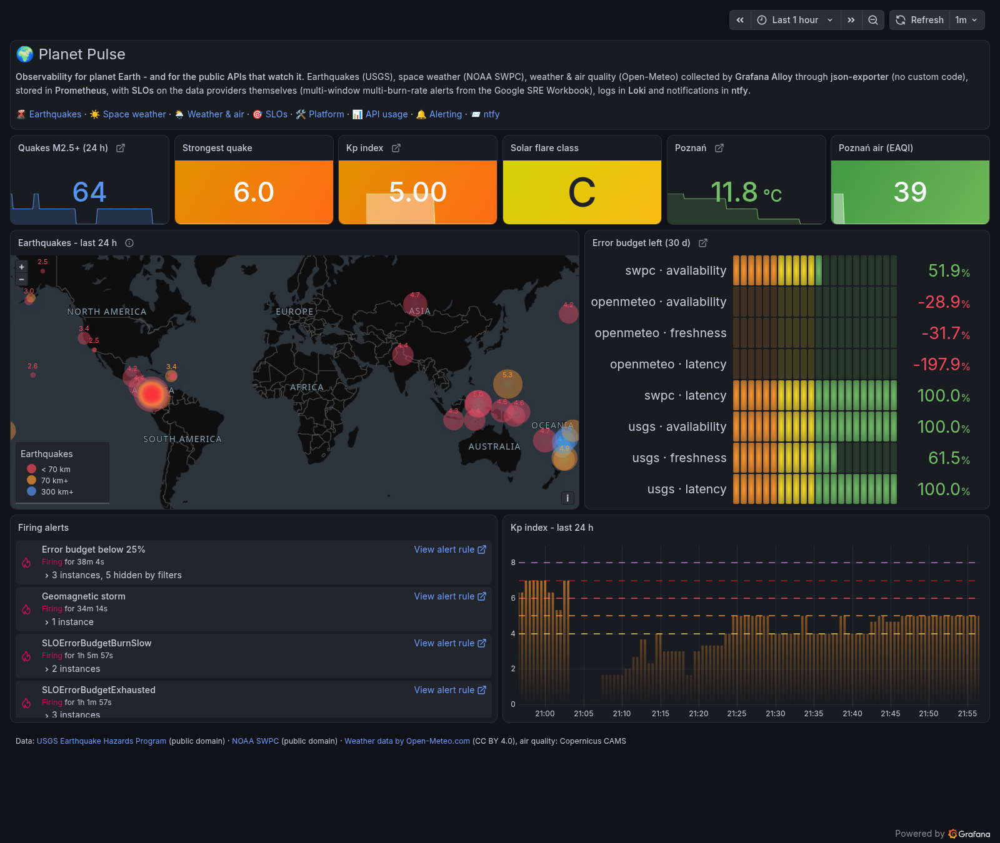

**Earthquakes**
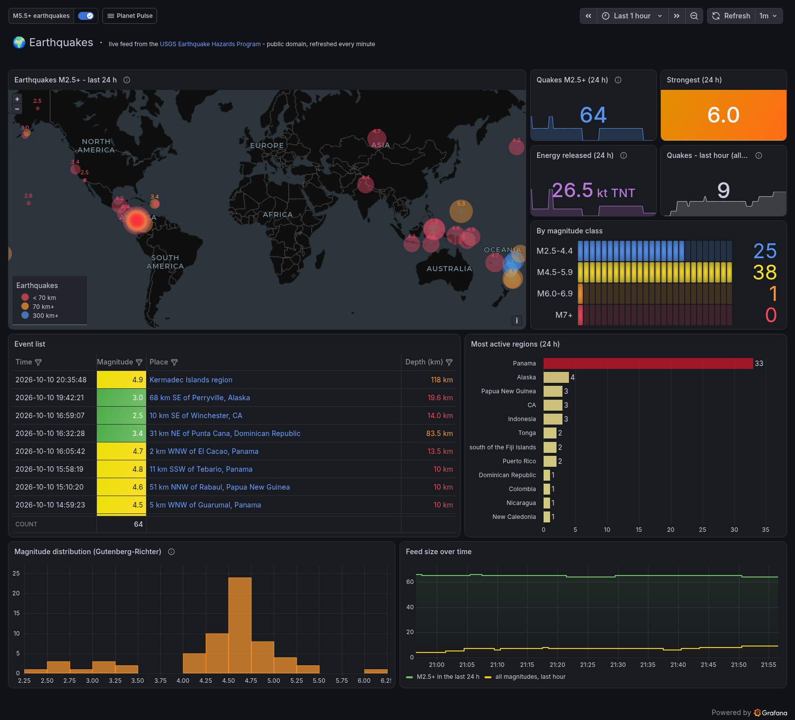

**Space weather**
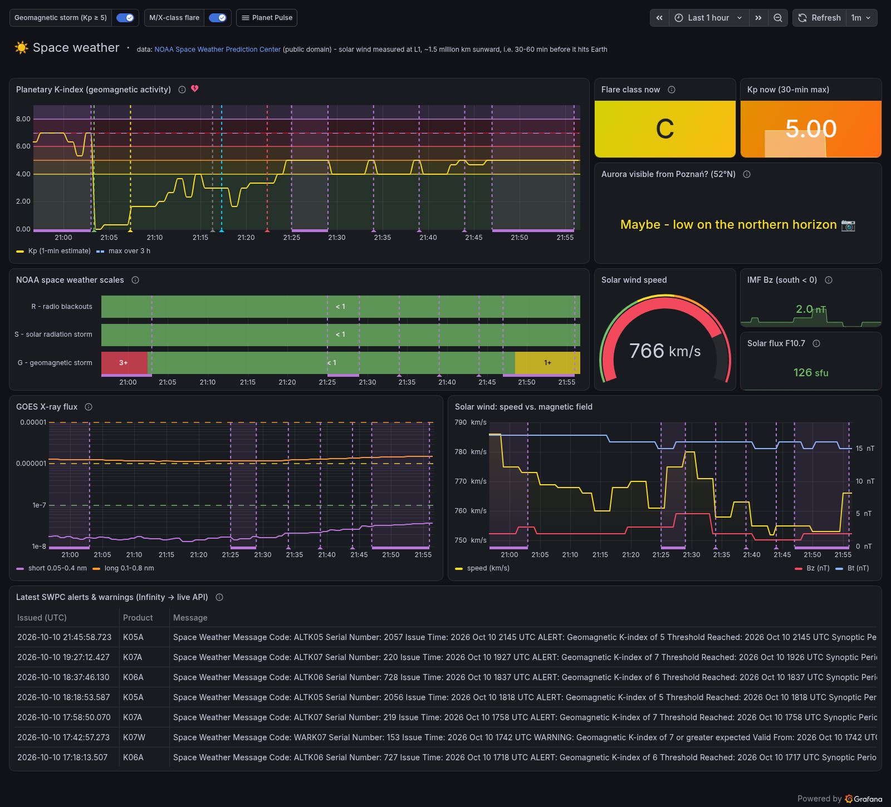

**Weather & air quality**
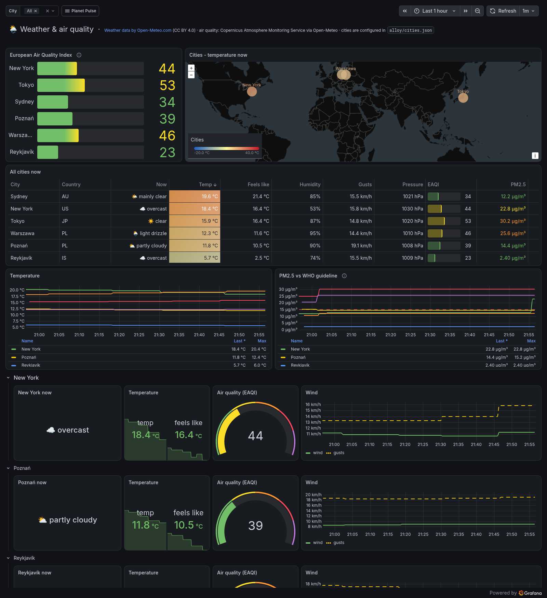

**SLO**
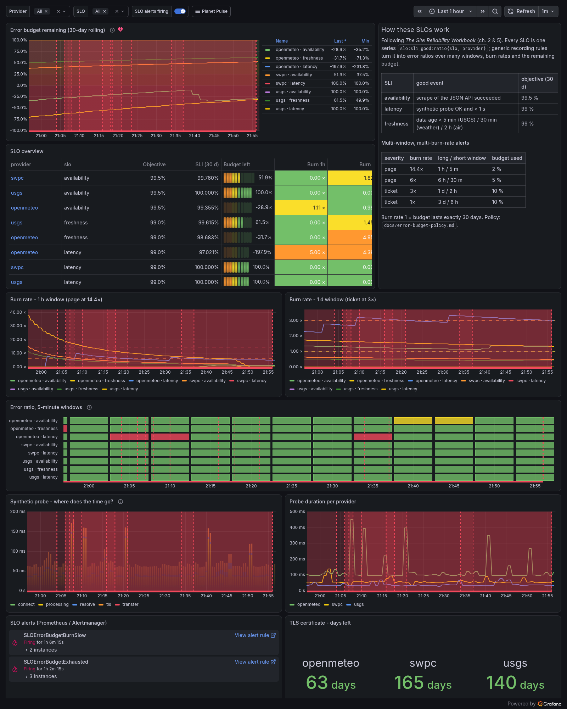

**Platform**
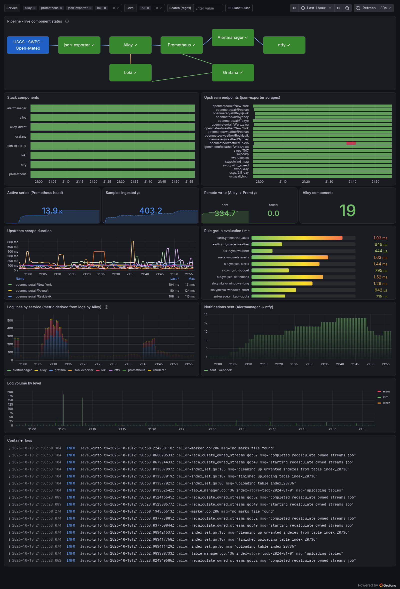

**API usage**
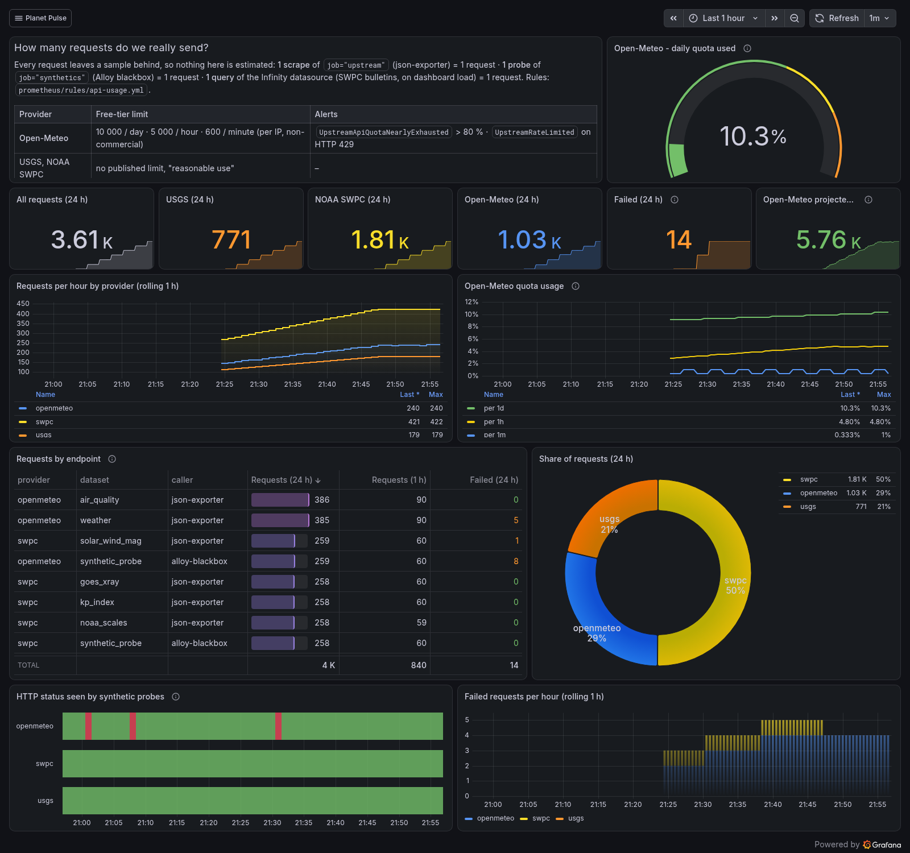

The screenshots are rendered by the bundled `grafana-image-renderer` (`make screenshots`).
They show the last hour of 2026-10-10, as the real G3 geomagnetic storm was fading (Kp dropping
from 7 to 5). Rolling-window panels (24 h counts, 30-day SLOs) are computed over their own windows.
</details>

### Grafana features used

Provisioned datasources (Prometheus, Loki, Alertmanager, Infinity) · **correlations**
(Prometheus series → Loki logs) · file-provisioned dashboards with folders · query, custom and
textbox variables · repeated rows · transformations (merge, organize, convert field type,
sort, limit) · value & range mappings · thresholds & overrides · data links & dashboard links ·
Prometheus annotations (incl. series value as timestamp) · Geomap (markers + heatmap) · Canvas ·
state timeline · status history · histogram · bar chart · pie chart · bar gauge · gauge · table cell gauges ·
logs panel · alert list · **Grafana-managed alerting** (multi-dimensional rules, recovery
thresholds/hysteresis, `keepFiringFor`, notification templates, contact points, notification
policies, mute timings) · server-side **image rendering** · anonymous access · custom home dashboard.

## Quality gates

Everything is checked in CI ([`.github/workflows/ci.yml`](.github/workflows/ci.yml)) and
locally with nothing but Docker:

```bash
docker compose run --rm promtool check config /etc/prometheus/prometheus.yml           # config + all rule files
docker compose run --rm promtool test rules tests/slo_test.yml tests/domain_test.yml tests/api_usage_test.yml  # unit tests
docker compose run --rm pint                                                            # PromQL linter (Cloudflare pint)
docker compose run --rm amtool                                                          # Alertmanager config
docker compose run --rm alloy-validate                                                  # Alloy pipeline
```

`make check` runs all of them on Linux/macOS. In Git Bash on Windows, prefix the commands with
`MSYS_NO_PATHCONV=1` so absolute container paths aren't rewritten.

**Unit tests** ([`prometheus/tests/`](prometheus/tests)) feed synthetic time series into the
rules and assert on the results. They cover: a hard outage pages, but only after `for:`; a 2 %
leak opens a ticket and does *not* page; the latency SLI requires both success and speed;
freshness with `last_over_time` catches a feed that stopped updating; flare classes A–X and the
zero-flux gap; the Kp → G-scale mapping and the 3-hourly Kp reset; request counting per
scrape/probe/Infinity query; the quota alert at 80 %; HTTP 429 detection; Gutenberg-Richter energy; the region regex; schema
drift; impossible values.

**pint** enforces house rules ([`.pint.hcl`](.pint.hcl)): every alert has `severity` ∈
{none, ticket, page} and a `summary`, every page has a `runbook_url`.

CI also checks that all dashboards are valid JSON with unique UIDs and that every YAML config
parses. Dependabot ([`.github/dependabot.yml`](.github/dependabot.yml)) proposes image and
Action updates.

## Configuration

Everything has a default. Copy [`.env.example`](.env.example) to `.env` (git-ignored) to change it.

| Variable | Default | Meaning |
|---|---|---|
| `GF_SECURITY_ADMIN_USER` / `GF_SECURITY_ADMIN_PASSWORD` | `admin` / `admin` | Grafana admin account |
| `GF_ANONYMOUS_ENABLED` | `true` | allow access without logging in |
| `GF_ANONYMOUS_ROLE` | `Editor` | role of anonymous users (`Viewer` for read-only) |
| `GF_RENDERER_TOKEN` | `change-me-renderer-token` | shared secret between Grafana and the image renderer |
| `BIND_ADDR` | `127.0.0.1` | interface that all published ports bind to |

## Customising

**Add a city.** Append an entry to [`alloy/cities.json`](alloy/cities.json). Alloy picks it up
within a minute, no restart needed:

```json
{"targets": ["json-exporter:7979"], "labels": {"city": "Kraków", "country": "PL", "lat": "50.06", "lon": "19.94"}}
```

Each city costs about 720 Open-Meteo calls per day (2 APIs, every 4 minutes). Stay below the free
limit of 10 000/day. The **API usage** dashboard shows the real count and a projection, and
`UpstreamApiQuotaNearlyExhausted` fires at 80 %.

**Add a dataset.**
1. Add a module with JSONPath expressions to [`json-exporter/config.yml`](json-exporter/config.yml).
2. Add a target to `prometheus.scrape "upstream_space_earth"` in
   [`alloy/config.alloy`](alloy/config.alloy) with `provider`, `dataset` and `instance` labels.
   It's then automatically part of the availability SLO for that provider.
3. `docker compose restart json-exporter alloy`

**Change an SLO.** Objectives are recording rules (`slo:objective:ratio`) at the top of
[`prometheus/rules/slo.yml`](prometheus/rules/slo.yml). Burn rates, budgets, alerts and
dashboards follow automatically. Run the unit tests afterwards and reload Prometheus:
`curl -X POST http://127.0.0.1:9090/-/reload`.

**Edit dashboards.** Edit and save directly in the Grafana UI. To keep a change in the repository,
use *Export → Export as JSON* and replace the file in `grafana/dashboards/`. Grafana reloads
changed files within 30 seconds, and a changed file overwrites the UI version.

## Operations & troubleshooting

```bash
docker compose ps                    # status
docker compose logs -f alloy         # logs of one service (or use Grafana → Explore → Loki)
docker compose down                  # stop, keep data
docker compose down -v               # stop and delete all data (TSDB, logs, Grafana DB)
```

| Symptom | Likely cause / fix |
|---|---|
| Dashboards empty right after start | Normal for the first 1–4 minutes. Check http://127.0.0.1:12345 for unhealthy Alloy components. |
| Weather panels empty, `UpstreamRateLimited` / `UpstreamScrapeFailing` for Open-Meteo | HTTP 429: quota exhausted (too many cities, shorter interval, or a shared IP). Check the [API usage](http://127.0.0.1:3000/d/pp-api-usage) dashboard, then wait or increase `scrape_interval`. |
| Flare class shows *no data* | GOES sometimes reports zero flux (provider-side gap, see `UpstreamDataInvalid`). |
| Gaps in graphs | The stack (or the machine) was off. Gaps longer than 10 minutes are drawn as gaps, not interpolated. SLO windows count the restart period, so budgets can dip after downtime. |
| No container logs in Loki | Alloy reads `/var/run/docker.sock`. With rootless Docker or Podman, adjust the socket path in `docker-compose.yml`. |
| `docker compose run ... promtool` fails with odd paths on Windows | Git Bash rewrites `/etc/...`. Use `MSYS_NO_PATHCONV=1` or run it from PowerShell. |
| Port already in use | Another local Grafana/Prometheus is running. Stop it or change the left side of the port mapping. |
| SLO budgets look extreme on a fresh install | The 30-day windows contain only minutes of data, so one slow probe weighs a lot. They stabilise over days. |

## Security

This is a **local demo**, so the defaults favour convenience, but they're contained:

- every published port binds to **127.0.0.1**,
- Grafana allows **anonymous editing**, and Prometheus, Alertmanager, Loki, ntfy and the Alloy UI
  have **no authentication**,
- Alloy mounts the **Docker socket read-only** to collect container logs,
- no secrets live in the repo: `.env` is git-ignored, and the data sources need no API keys.

Read [SECURITY.md](SECURITY.md) before exposing anything beyond your machine.

## Data sources & attribution

| Source | Data | License | Polling |
|---|---|---|---|
| [USGS Earthquake Hazards Program](https://earthquake.usgs.gov/earthquakes/feed/v1.0/geojson.php) | M2.5+ quakes (24 h), all quakes (1 h) | Public domain (U.S. Government) | 1/min (feeds regenerate every minute) |
| [NOAA Space Weather Prediction Center](https://services.swpc.noaa.gov/) | Kp, GOES X-ray, solar wind, NOAA scales, F10.7, alerts | Public domain (U.S. Government) | 1/min |
| [Open-Meteo](https://open-meteo.com/) | current weather & air quality (Copernicus CAMS) | **CC BY 4.0**, *Weather data by Open-Meteo.com* | every 4 min × 6 cities × 2 APIs + 1 probe/min ≈ **5 800 calls/day**, under the 10 000/day free non-commercial limit |

These numbers aren't estimates: [`prometheus/rules/api-usage.yml`](prometheus/rules/api-usage.yml)
counts every real request (one per scrape, probe or Infinity query) and the **API usage**
dashboard shows them per endpoint.

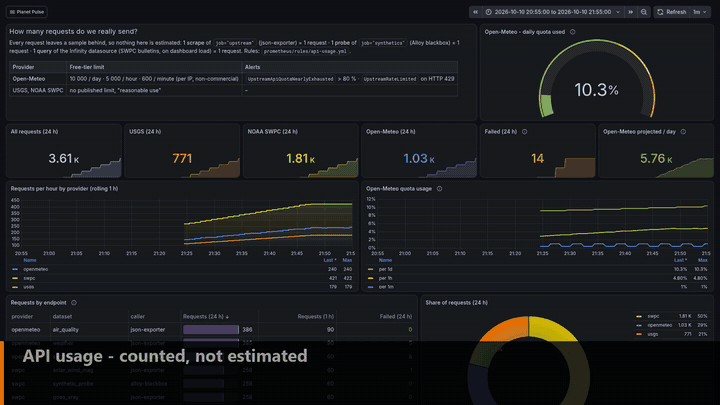

Synthetic probes send a descriptive `User-Agent`. Please keep
the polling polite if you fork this. The Open-Meteo free tier is for **non-commercial** use only.

USGS and NOAA data are provided for information only. **Planet Pulse is not a warning system.**
For tsunami or space-weather warnings, use the official sources (tsunami.gov,
swpc.noaa.gov).

## Project layout

```
planet-pulse/
├── docker-compose.yml          # 8 services + tooling (profile "tools")
├── .env.example                # all settings, documented
├── json-exporter/config.yml    # JSONPath → metrics, one module per API
├── alloy/
│   ├── config.alloy            # scrape, relabel, blackbox, logs, remote_write
│   └── cities.json             # file SD: add a city here
├── prometheus/
│   ├── prometheus.yml
│   ├── rules/                  # slo.yml · earth.yml · meta.yml · api-usage.yml
│   └── tests/                  # promtool unit tests
├── alertmanager/alertmanager.yml
├── loki/loki.yml
├── grafana/
│   ├── provisioning/           # datasources, dashboards, alerting (rules, contact points, policies, templates)
│   └── dashboards/             # Planet Pulse/*.json, Platform/*.json (platform, api-usage)
├── docs/                       # runbooks, error budget policy
│   ├── img/                    # screenshots + README GIFs
│   └── video/                  # 79-second project video (MP4)
├── .pint.hcl                   # PromQL lint rules
├── Makefile                    # shortcuts for Linux/macOS
├── SECURITY.md
└── .github/                    # CI workflow, Dependabot
```

## Known limitations

- SWPC timestamps are strings, so json-exporter can't read them and SWPC has no freshness SLI.
- `usgs_earthquake_*` has one series per quake (≈ 50–150 at a time, rotating daily). That's fine
  here. In a bigger system, events belong in Loki or a SQL store, not in a TSDB.
- SLIs are sampled at rule-evaluation time (every 30 s), so they're event-based only approximately.
  This is the usual trade-off of `avg_over_time`-based SLOs.
- Single node, no HA, no long-term storage. This is a portfolio project, not a production deployment.

## License

Code: [MIT](./LICENSE) © 2026 jeti20. The data shown stays under its providers' terms above
(Open-Meteo requires attribution, which is on every relevant dashboard).
